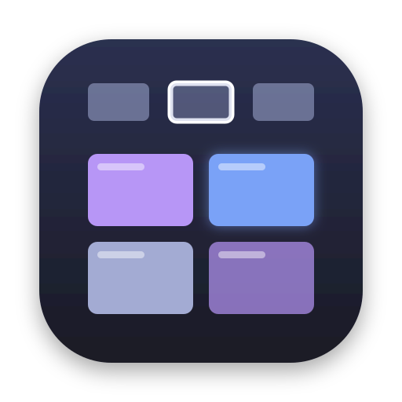
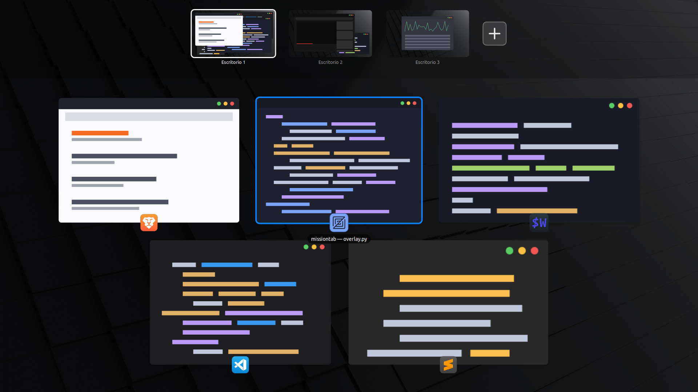

<p align="center"></p>

<h1 align="center">MissionTab</h1>

<p align="center">
  <b>macOS Mission Control for the MATE desktop.</b><br>
  Every workspace at the top, every window below — live, draggable, one shortcut away.
</p>

<p align="center">
  
  
  
  
</p>

<p align="center"></p>

## Why

Linux MATE has virtual desktops, but no way to *see* them. You switch blind, you move windows with menus, and
you never know what is sitting on desktop 3. On macOS, one gesture shows everything and you rearrange it by
dragging. MissionTab brings that to MATE — a sibling of [ListTab](https://github.com/andysierra/Listtab),
the window-list Alt+Tab.

## What it does

Press **Ctrl+Super+↑** (like Ctrl+↑ on a Mac):

| You want to… | Do this |
|---|---|
| Go to a window | **click** it · or arrows + **Enter** |
| Move a window to another workspace | **drag** it onto that workspace |
| Put a window on a new workspace | drag it onto **+** |
| Add a workspace | click **+** |
| Remove a workspace | hover it → **×** (its windows move to the one on its left) |
| Peek at another workspace | **hover** it for 700 ms — or **Ctrl+←/→** |
| Go to a workspace | click it · or **1–9** |
| Leave | **Esc**, the shortcut again, or click the background — you return where you started |

- **Live thumbnails.** Windows show their real contents, even when covered by others. Windows on other
  workspaces show their last snapshot (or the app icon if never seen), just like macOS.
- **Real app icons**, including web apps (PWAs) installed from Brave/Chrome.
- **Instant.** A small resident process keeps the thumbnails ready; the shortcut only asks it to show the view.
- **Never traps you.** It is a normal window: Esc, Alt+F4 or the shortcut always close it.

## Install

**From a release** (`.deb`, Debian/Ubuntu/Linux Mint with MATE on X11):

```bash
sudo apt install ./missiontab_0.1.1_all.deb
```

Then **open MissionTab once** from the applications menu (or log out and back in). From then on it starts at
every login and **Ctrl+Super+↑** opens it. The shortcut is created on first run, unless you already have one for
MissionTab or that combination is taken. Uninstall: `sudo apt remove missiontab`.

**From source** — nothing to compile:

```bash
git clone https://github.com/andysierra/missiontab && cd missiontab
bin/missiontab --daemon &   # resident process
bin/missiontab              # show / hide the view
```

Needs an X11 session, a compositor (Marco's is on by default in Linux Mint), and
`python3-gi python3-gi-cairo python3-cairo gir1.2-gtk-3.0 gir1.2-wnck-3.0` — all preinstalled on Mint MATE.

## How it works

| Piece | File | Technique |
|---|---|---|
| Resident process + shortcut | `app.py`, `shortcut.py` | single-instance `Gtk.Application` (D-Bus); MATE custom keybinding |
| Workspaces & windows | `model.py` | libwnck; workspace count through Marco's GSettings |
| Thumbnails | `thumbs.py` | read redirected (composited) windows; cache the last good capture |
| Exposé layout | `layout.py` | tries every row count, keeps the one with the largest total area |
| View | `overlay.py` | full-screen GTK window drawn with cairo + Pango; sticky, so it survives workspace switches |

## Developing

```bash
bin/missiontab --list                      # workspaces and windows
bin/missiontab --render=/tmp/x.png         # draw the view to a PNG without showing it
bin/missiontab --render=x.png --demo       # with fake windows (used for the screenshot above)
touch ~/.missiontab-debug                  # log to ~/.cache/missiontab.log
packaging/build-deb.sh                     # build dist/missiontab_<version>_all.deb
```

## License

[MIT](LICENSE) © andysierra
